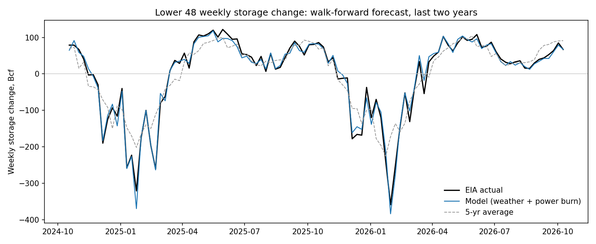

# Henry Hub storage: weekly injection and withdrawal forecast

[](https://github.com/syulimo/henry-hub-storage/actions/workflows/ci.yml)
[](https://github.com/syulimo/henry-hub-storage/actions/workflows/live.yml)
[](LICENSE)

A walk-forward forecast of the EIA weekly Lower 48 storage change from NOAA CPC degree days and EIA-930 gas-fired generation, benchmarked against the analyst consensus, the five-year average and last week's change. Point-in-time throughout: each week's forecast uses degree days and generation only through the Friday that ends that week (both published within a day, before Thursday's EIA release) and storage data only through the prior week. Tests assert that altering any figure published after the forecast date leaves every forecast, and the consensus blend, unchanged.

## Results

**Against the analyst consensus, the bar a desk uses.** Over 231 weeks (2022-01-21 to 2026-10-09) the consensus misses the EIA print by 8.0 Bcf on average and the model by 10.4, so the model does not replace the consensus. What it does carry is information the consensus does not: when the model and the consensus disagree, the print lands on the model's side of the consensus 57.6% of the time (p = 0.025, two-sided binomial), and 63.3% of the time from November to March (p = 0.015). A point-in-time blend, consensus plus a weight on the model's disagreement estimated only from past weeks, cuts RMSE from 10.17 to 9.57 Bcf at the same MAE (7.27 vs 7.28).

| Forecast, 231 weeks | MAE (Bcf) | Median abs error | RMSE |
|---|---|---|---|
| Consensus (Investing.com) | 8.04 | 5.00 | 14.08 |
| Full model | 10.39 | 7.40 | 14.28 |
| Weather only | 12.54 | 9.35 | 16.43 |
| 5-yr average | 30.90 | 21.00 | 45.03 |

| Model's disagreement with consensus | Weeks | Print on model's side | p (two-sided) |
|---|---|---|---|
| All weeks | 231 | 0.576 | 0.025 |
| November to March | 90 | 0.633 | 0.015 |
| April to October | 141 | 0.539 | 0.400 |
| Gap above 3 Bcf | 189 | 0.603 | 0.006 |
| Gap above 5 Bcf | 160 | 0.619 | 0.003 |
| Gap above 8 Bcf | 111 | 0.595 | 0.057 |
| Gap above 12 Bcf | 71 | 0.634 | 0.032 |

The "all weeks" row was the first test run; the other rows were run in the same pass and are descriptive, not separate findings. That is a result on the print; whether it pays is the next paragraph. Sources: `output/consensus_accuracy.csv`, `output/consensus_direction.csv`, `output/predictions_vs_consensus.csv`.

**Does it pay in the futures market? Not demonstrably.** The market does react to storage surprises as it should: across 213 release days, a 10 Bcf larger build than consensus goes with a 0.56% lower front-month settlement on release day (t = -2.85). Holding one contract against the model's disagreement with consensus, from the prior settlement to the release-day settlement, earned 45 bp per week gross and 35 bp after an assumed three-tick round-trip cost, but with a t-statistic of 1.5 gross and 1.2 net and a 50.7% hit rate, which is not distinguishable from zero. It is stronger in November to March weeks (80 bp gross, t = 1.7, hit rate 60%) and weaker in 2024 to 2026 (17 bp, t = 0.5) than in 2022 to 2023 (80 bp, t = 1.6). Release-day settlement-to-settlement returns also carry all of the day's other news, so the next paragraph narrows the window to the hour around the release.

| Holding -sign(model minus consensus) | Weeks | Gross bp per week | t | Net bp per week | t | Hit rate |
|---|---|---|---|---|---|---|
| All | 213 | 44.8 | 1.55 | 35.2 | 1.21 | 0.507 |
| November to March | 82 | 80.4 | 1.72 | 70.8 | 1.52 | 0.598 |
| April to October | 131 | 22.5 | 0.61 | 12.8 | 0.35 | 0.450 |
| Gap above 5 Bcf | 148 | 66.0 | 1.91 | 56.7 | 1.64 | 0.534 |

Prices: NYMEX Henry Hub contracts 1 and 2 from EIA (series RNGC1, RNGC2) through 2024-04-05, when EIA stopped publishing them; after that, contract 1 from Yahoo Finance NG=F, retrieved 2026-10-15 and saved as `data/futures_yahoo.csv` (SHA-256 1623f2c8cd670de67fa085e8122e5970ce6b4de864316f86400b952028712fd6), which matched EIA contract 1 exactly on all 567 overlapping days. When the release falls on the front contract's last trading day, contract 2 is used, so expiry squeezes (the 2022-01-27 expiry jumped from 4.28 to 6.27) do not count as storage reactions; 18 of the 231 weeks are dropped because they need a contract 2 price after April 2024. Sources: `output/price_reaction_beta.csv`, `output/price_reaction_signal.csv`, `output/price_reaction.csv`, produced by `python price_reaction.py`.

**Around the release itself, the reaction is sharper and the signal is still not proven.** Hourly prices narrow the window to 10:00 to 11:00 ET on Thursday releases (10:00 to 13:00 on Wednesday or Friday holiday releases, which come out later). Over 111 releases (2024-05-23 to 2026-10-15), a 10 Bcf larger build than consensus goes with a 0.58% lower price within the hour (t = -4.3, R-squared 0.15 against 0.04 on settlements), and the price moves against the surprise 66% of the time. Positioning against the model's disagreement at 10:00 earned 24 bp per week gross (t = 1.5) and 14 bp net (t = 0.9), hit rate 57.7%. The weeks with a gap above 5 Bcf earned 38 bp net (t = 2.0), but that subset was chosen alongside the others, so it is a lead for the live record, not a finding.

| 10:00 to 11:00 ET | Weeks | Gross bp | t | Net bp | t | Hit rate |
|---|---|---|---|---|---|---|
| All | 111 | 23.6 | 1.55 | 13.9 | 0.91 | 0.577 |
| November to March | 36 | 48.3 | 1.72 | 40.1 | 1.43 | 0.667 |
| April to October | 75 | 11.8 | 0.65 | 1.3 | 0.07 | 0.533 |
| Gap above 5 Bcf | 71 | 47.3 | 2.52 | 37.8 | 2.01 | 0.606 |

Hourly bars: Yahoo Finance NG=F, 60-minute bars in US Eastern time, available from 2024-05-23; the 09:00, 10:00, 11:00 and 13:00 prices for each release day were saved as `data/futures_hourly_yahoo.csv` (SHA-256 8436bf51582fa22141f60ca07641ba8193c9b08e7e48915e605b171e7137472a). Release days on or one day before a front contract's last trading day are dropped. Sources: `output/price_reaction_intraday_signal.csv`, `output/price_reaction_intraday.csv`.

**Against the simple benchmarks.** Over 247 weeks (2022-01-21 to 2026-10-09), the full model misses by 10.5 Bcf on average, against 31.2 for the five-year average and 35.0 for naive, and gets the sign of the surprise versus the five-year average right 85% of the time; adding power burn cut the April to October error from 11.1 to 8.5 Bcf, while winter remains the hard part at 13.5 Bcf.

| Model | MAE (Bcf) | RMSE (Bcf) | Hit rate vs 5-yr avg |
|---|---|---|---|
| Full: weather + power burn | 10.45 | 14.21 | 0.85 |
| Weather only | 12.58 | 16.38 | 0.87 |
| v1: linear degree days | 16.63 | 20.99 | 0.77 |
| Naive (last week) | 35.03 | 53.15 | 0.64 |
| 5-yr average | 31.18 | 45.31 | n/a |

| Model | MAE Nov to Mar | MAE Apr to Oct |
|---|---|---|
| Full | 13.46 | 8.50 |
| Weather only | 14.82 | 11.12 |
| v1 | 18.28 | 15.56 |
| 5-yr average | 54.20 | 16.30 |

The weather-only model can start earlier because it does not need EIA-930: over 457 weeks (2018-01-05 to 2026-10-09) its MAE is 13.13 Bcf against 30.24 for the five-year average, hit rate 0.84.

Sources: `output/scores.csv`, `output/scores_by_season.csv`, `output/scores_weather_full_history.csv`, all computed from `output/predictions.csv`. Data: EIA storage through 2026-10-09, CPC degree days through 2026-10-13, EIA-930 through 2026-10-14.



## Method

- Target: weekly change in Lower 48 working gas, Bcf (EIA series NW2_EPG0_SWO_R48_BCF).
- Weather: weekly sums of CONUS population-weighted HDD and CDD (CPC `Population.Heating.txt`, `Population.Cooling.txt`), their squares (demand is convex in temperature), and last week's HDD and CDD. With last week's degree days in the model, last week's storage change minus its weather part carries the structural supply and demand balance forward.
- Power burn: weekly Lower 48 natural gas-fired generation from EIA-930 (`US48`, fuel `NG`), this week and last. EIA-930 has reporting gaps (2025-11-06 to 2025-12-10 and 2025-12-21 to 2025-12-31 show about 40% of normal); a day below half the median of the last 28 accepted days is treated as missing, and in those weeks the full model falls back to the weather forecast (10 weeks, flagged `pb_gap` in `predictions.csv`).
- Also included: last week's change and the five-year average change for the same ISO week, computed only from prior years.
- Model: OLS refit every week on a trailing three-year window.
- Benchmarks: naive (last week's change) and the five-year average.
- Scoring: MAE and RMSE in Bcf, plus hit rate of the forecast's sign versus the five-year average.
- Consensus: the weekly forecast and headline actual shown on Investing.com's economic calendar (event 386), retrieved 2026-10-15 from `https://endpoints.investing.com/pd-instruments/v1/calendars/economic/events/386/occurrences` and saved as `data/consensus_investing.csv` (489 releases from 2017-06-01; SHA-256 86c37b573d4948fb69bd737658aed75ef6e868232c55ad648762e85695f4f1da). It is not refetched by `fetch_data.py`. Each release is mapped to its report week (the Friday on or before release minus three days, which handles Wednesday and Friday holiday releases). Weeks are kept only when the headline actual matches the EIA level change within 1 Bcf; this drops a duplicated November 2023 release, weeks with reclassifications, and data errors. Four kept weeks have consensus misses over 40 Bcf that may be data errors on the source side (for example +63 for the week ending 2022-11-18, actual -80); dropping them lowers consensus MAE to 6.9 and model MAE to 10.3, and leaves the direction result at 57.9%.
- Blend: consensus + w x (model - consensus), with w the slope through the origin of past surprises on past gaps, starting after 52 weeks of history; the latest weight is about 0.49.

## Live record: the model is frozen

Because the variants in the next section were compared on the same out-of-sample window, the backtest is somewhat optimistic. The clean test is forward: the model was frozen on 2026-10-15 (SHA-256 of `model.py` is logged with every forecast), and each week a GitHub Action logs the forecast for the week that just ended on Monday, before the consensus forms and before Thursday's EIA release, then fills in the EIA actual and the Investing.com consensus after the release. The log is append-only and the commit history is the timestamp: [`forecasts/live_log.csv`](forecasts/live_log.csv). The first logged week is the week ending 2026-10-16, released 2026-10-22. A test checks that the live forecast for any week equals the backtest forecast for that week, so the live record measures exactly the model reported above.

## Model selection, stated plainly

Every variant tried is rerun by `python experiments.py` on the same 237 weeks and saved to `output/model_selection.csv`. Removing any kept piece makes the model worse: without last week's change 12.97 Bcf MAE, without last week's degree days 11.77, without the squares 10.53, without power burn 12.43, against 10.21 for the frozen model on these weeks. Nothing added beat it by more than noise: HDD weighted by utility-gas homes 10.58, coldest day of the week 10.19, days with HDD of 35 or more 10.17, freeze-off proxies from Census division HDD in Texas (division 7) and Appalachia (division 2) between 10.12 and 10.26 with winter MAE no better than 13.16, a 104-week window 10.61, a 260-week window worse on the weeks it can run (9.36 against 9.16 for 2024 to 2026), and Friday-to-Thursday weeks 11.03. The freeze proxies fail for a plain reason: only 11 weeks since 2022 had producing-region cold severe enough, too few for a three-year rolling regression. Because these comparisons all used the same window, the backtest is somewhat optimistic; the live record is the clean test.

## What this does not do, and why

- No daily production, LNG feedgas, pipeline or Canada and Mexico flow data. Winter is where the model is weakest (13.2 Bcf MAE) and its largest miss is the week ending 2023-01-06 (actual +11 Bcf injection, forecast -69), after Winter Storm Elliott. Free weather proxies for freeze-offs did not help (above); the data that would are pipeline flow and production estimates sold by commercial vendors.
- EIA-930 history is the current vintage, not as first published. The live record uses the data as published each Monday, so forward results do not have this issue.
- One consensus source. Investing.com's survey is the only weekly history freely available; Reuters, WSJ and Bloomberg run their own, which can differ.
- Intraday prices only from 2024-05-23 (111 releases), the history Yahoo Finance serves for hourly bars; earlier weeks are tested on settlements only.
- A nowcast, not a long-range forecast: it uses the week's realized weather, which is known by the Monday before the Thursday release, the same information a desk has when the consensus forms.
- Lower 48 only. Regional splits (East, Midwest, South Central salt and nonsalt) are the natural next step and the same code runs on the regional series.

## Run

```
pip install pandas numpy requests matplotlib pytest
python -m pytest tests -q          # synthetic data, no network
set EIA_API_KEY=your_key           # Windows cmd; on macOS or Linux: export EIA_API_KEY=your_key
python fetch_data.py
python model.py
python fetch_data.py futures        # futures prices for price_reaction.py
python price_reaction.py
python fetch_data.py regions        # Census division HDD for experiments.py, no key
python experiments.py              # every variant tried, on the same weeks
python live.py forecast            # log next week's forecast once its data are complete
python live.py score               # after the EIA release
```

A free EIA API key is at https://www.eia.gov/opendata/register.php; the live workflow reads it from the repository secret `EIA_API_KEY`. The `data/` folder is committed, so `python model.py` reproduces every result, including the consensus comparison, without a key.
